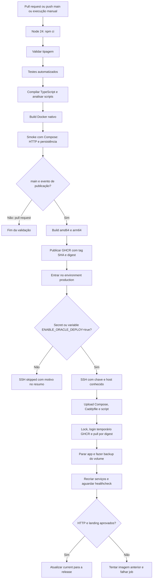
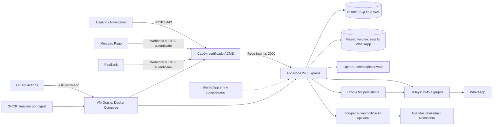

# Fluxo de entrega e execução

A aplicação é entregue em uma única imagem Docker, com um único processo para Express, bot, tarefas agendadas e filas. O Caddy é o segundo serviço do Compose, responsável por TLS e encaminhamento HTTP. O banco e a sessão WhatsApp permanecem no volume durante trocas da imagem.

## Pipeline

Pull requests não recebem secrets de produção, não publicam imagens e não fazem deploy. A etapa `validate` precisa passar para `image`; `deploy` depende de `image`. A imagem nativa é executada no CI; as duas arquiteturas são publicadas, mas a execução ARM deve ser homologada em uma VM ARM. Não há deploy concorrente nem atualização de código por `git pull` na VM.

## Aplicação na Oracle

Somente 80/443 são publicados pelo Compose; 80 atende redirecionamento/ACME. O Express confia em um proxy quando `TRUST_PROXY=1`, e o Caddy sobrescreve os cabeçalhos de origem. O host SSH é acessado pela porta configurada fora do Compose. Credenciais financeiras e da IA ficam em `shared/app.env`, nunca na imagem. O GitHub precisa apenas dos dados de conexão SSH; o token de leitura do registry dura o job.

O healthcheck confirma que o processo HTTP responde, não a disponibilidade das integrações. A confirmação de pagamento é persistida antes da resposta HTTP, e convites/remoções aguardam o bot estar conectado. O rollback troca a imagem/Compose e preserva o estado; uma eventual reversão de dados exige revisão separada.
